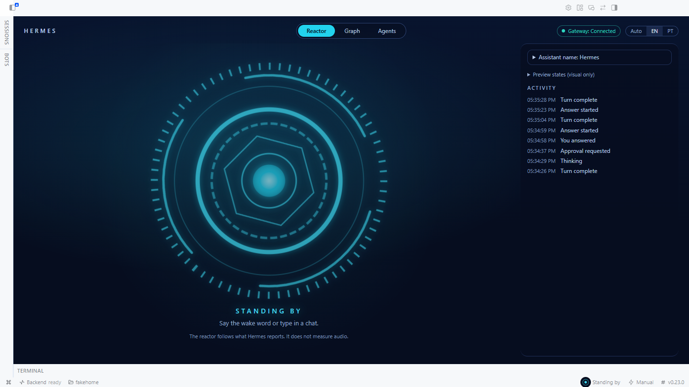
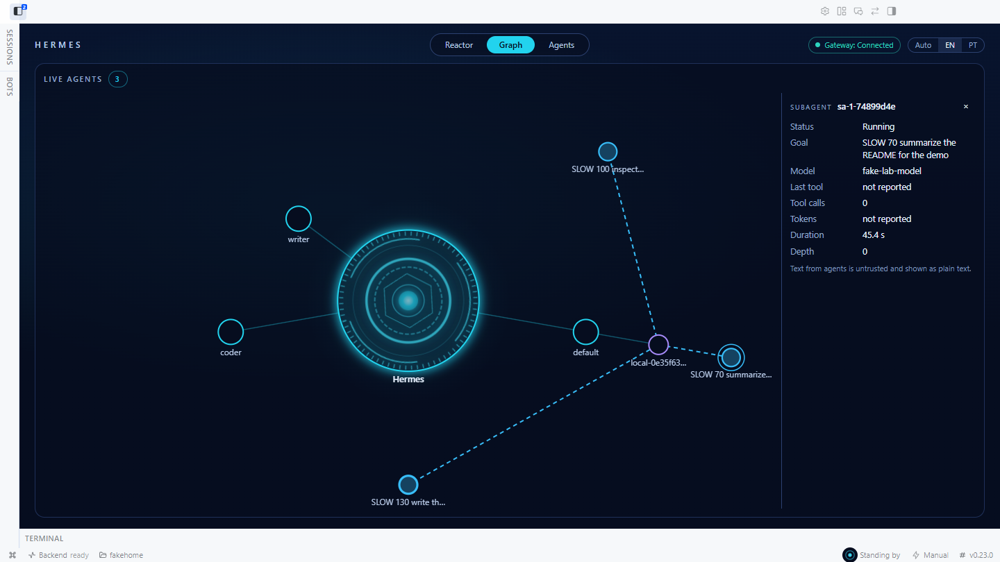
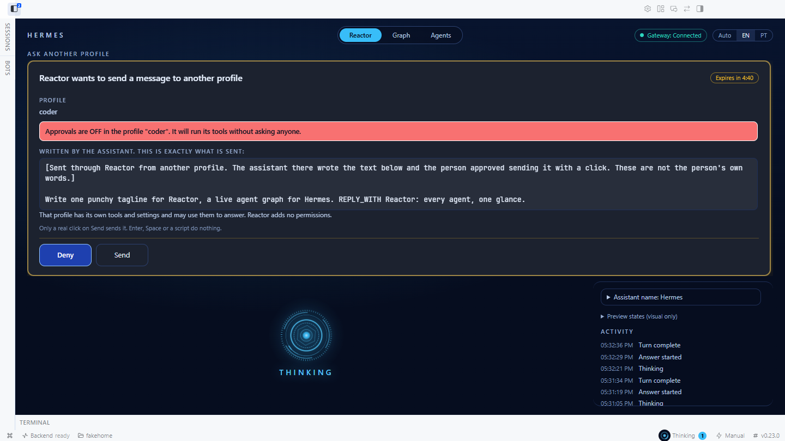

# Reactor for Hermes

A live agent graph and a voice command center, built as a Hermes Agent plugin (id `hermes-reactor`). Reactor descends from
the author's Jarbas project, a standalone voice assistant; nothing else is shared. Hermes supplies the wake word, speech to
text, text to speech, sessions, approvals and sign-in. Reactor adds:

- **a stage with the reactor as the hero** and a `Reactor | Graph | Agents` switch that fits a 1280x720 window without page
  scrolling,
- **a live agent graph** in Hermes Desktop: the Hermes reactor in the middle (the node carries the reactor artwork), your profiles
  around it, the sessions that are doing something, and every subagent they spawn, with status, goal, model, last tool, tokens and duration. A wake lights the
  profile that was woken (`desktop/plugin.js`, built from `src/`),
- **voice-requested screens**: say "show me the graph" or "open the kanban" and the model opens it, from a closed list,
- **talk to any profile**: the model drafts a message for another profile and a card shows the exact words; you click Send and the
  reply appears on the card,
- **a name for your assistant**: Hermes by default, free text up to 24 characters (presets: Hermes, Jarbas),
- **a read-only Kanban status line** and a badge on Kanban cards showing the worker state,
- an agents panel for your Claude Code and Codex sessions, spoken briefings, and a continue flow that really runs a session, but
  only after you click Run on a large card,
- approval cards that explain, in two fixed sentences, what a command does and what may happen. Answers are by click only.

It never approves anything for you, never turns a guard off, never writes a persona file or a profile, never writes to Kanban,
and makes no network calls of its own.







(Hermes Desktop 0.23.0 in an isolated lab with a fake local model. More in "Proved in a real Hermes Desktop" below, and a dark
Hermes theme in `docs/media/24-hermes-reactor-dark-theme.png`.)

## Python tools

| Tool | What it does |
|---|---|
| `reactor_show(view)` | Opens one of `stage`, `graph`, `agents`, `profiles`, `kanban`, `cron`, `messaging`, `capabilities` in Desktop. Sends one plugin event; an unknown view does nothing. At most one screen change per 3 seconds (`rate_limited`), and none while a card waits for a click (`card_pending`). |
| `reactor_ask_profile(profile, message)` | Validates and puts a **Send card** in Reactor. Returns only `{status: "awaiting_click", proposal_ref}`. **Sends nothing.** Refuses the profile it runs in (`cannot_ask_self`). See below. |
| `reactor_list_sessions(query?, limit?)` | Compact rows `{ref, agent, title, folder, age, turns, resumable}`. `ref` is opaque (the first 12 hex digits of the id Desktop shows for the row). |
| `reactor_session_brief(ref)` | The last few turns, trimmed and wrapped as untrusted data. |
| `reactor_continue_session(ref, instruction)` | Validates and puts a card in Reactor. Returns only `{status: "awaiting_click", proposal_ref}`. **Runs nothing.** See below. |
| `reactor_explain_risk(command)` | Fail-closed classifier with fixed English and PT-BR sentences. Never runs the command. |

Hooks: `pre_llm_call` (one context line: the assistant's name and "reply in the user's language"), and four read-only Kanban
observers (`kanban_task_claimed`, `kanban_task_completed`, `kanban_task_blocked`, `on_kanban_task_updated`).

`skills/reactor/SKILL.md` is a short bilingual persona: brief spoken replies, uses these tools, treats session content as data,
knows that every action needs a click. Load it with `skill_view("hermes-reactor:reactor")`. The default wake guidance is
"hey hermes"; to use another phrase set `wake_word.phrase` (see "Voice setup").

## Live agent graph

Open the page (sidebar "Reactor", or say "show me the graph"). The graph is plain SVG, drawn from a pure, tested model.

- **Nodes:** the reactor in the center (it carries the assistant's name), one node per profile (from `host.profiles.list()` and
  `host.profileRoutes()`, so profiles served by another connection show too), the sessions that are doing something, and the
  subagents, each hanging from its parent (or from its session when the parent is not known).
- **Edges and colours:** parent to child. Queued is amber and dashed, running is cyan and pulsing with flowing edges, done is
  green with a check, failed, error and timed out are red, interrupted is orange, unknown is grey and dashed. Glyphs repeat the
  status so colour is not the only cue.
- **Click a node** (or focus it and press Enter) to see its goal, model, last tool, tool count, tokens in and out, duration,
  depth and parent. Text that came from an agent is cleaned and drawn as text.
- **Sources:** `subagent.spawn_requested|start|thinking|tool|progress|complete` events for live updates; `delegation.status`
  (everything active) as the authoritative list of what is still running; `subagent.list` for the focused chat; the newest
  `spawn_tree.list` / `spawn_tree.load` snapshot once per connection as history. A `wake.detected` lights the profile it names
  (or the default profile when it names none) for six seconds.
- **Robust against:** late events (a finished agent never comes back to life), events for ids nobody announced, unknown parents,
  parent cycles, hundreds of agents (300 kept, 60 drawn, running first, the rest counted as "+N more"), and reconnects (after a
  drop running nodes are dimmed until Hermes confirms them).
- **Limits, stated plainly:** only the launch profile's delegation tree is listed by `delegation.status`; other profiles'
  children appear through live events while this window is connected. The saved trees only exist if some client saved them.

## Voice-requested screens

`reactor_show(view)` sends the plugin event `plugin.hermes-reactor.show` through Hermes' public event bridge
(`hermes_cli.plugin_events.broadcast_plugin_event`). Desktop validates the name against the same closed list and calls
`host.navigate` (stage, graph, kanban) or `ctx.runAction` with `nav.agents`, `nav.profiles`, `nav.cron`, `nav.messaging` or
`nav.capabilities` (view and navigation actions only). An unknown view does nothing at all. Kanban ships off in Desktop
0.23.0: when it is off the person gets a notice instead of a dead page. Guards, in Python and again in Desktop: **one navigation per 3 seconds for all views together**, and **none while an
approval, a continue or an ask card is waiting** (the screen is never moved or scrolled under a card the person has to read).
The tool answers `rate_limited` (with `retry_after_s`) or `card_pending` with a sentence the model can read. Desktop also
ignores the same view twice within two seconds and a replayed event never navigates; a click on a chat button is the person's
own and is not throttled. A chat directive `::reactor-show{view="graph"}` draws a **button**; rendering never navigates.

## Ask another profile: your click, not the model's

1. The model calls `reactor_ask_profile("writer", "Write a tagline...")`. The tool validates (strict profile name, the profile
   folder exists, the text cleaned, at most 4000 characters and 40 lines counting the provenance line, or it is refused, never cut) and keeps an ask **in server
   memory**: 5 minutes, single use, at most 5 pending. The model gets `awaiting_click` and a label. It never gets the id, the text
   back, or anything that can send it, cancel it or read the reply.
2. A card names the **target profile**, shows **the exact message**, labelled as written by the assistant, and warns that the
   profile has its own tools and settings. Reactor puts one fixed provenance line in front of the model's text ("Sent through
   Reactor from another profile. The assistant there wrote the text below and the person approved sending it with a click. These
   are not the person's own words."); the card shows that line as part of the message, so **the text shown is the text sent**.
   The card also reads the target profile's own `config.yaml` (read only, through `hermes_constants.get_default_hermes_root` and
   `hermes_cli.config.read_user_config_raw`): when `approvals.mode` is off a red banner says that profile will run its tools
   without asking anyone, and when the setting cannot be read it says "Could not verify". A process-wide `--yolo` or a session
   `/yolo` toggle lives in memory and cannot be seen from here. Deny holds the focus. Send works with a real click only
   (`event.detail > 0`) and, like Run and Allow, stays disabled for 700 ms after the card appears and again for 700 ms after
   its text or size changes. Enter, Space or a script do nothing.
3. On the click Desktop finds the profile's route first (a missing or ambiguous route releases nothing), then asks the backend to
   release the ask (once; the text is wiped there), then sends through `host.requestProfile`: `session.create`, `prompt.submit`,
   `session.history`, holding `host.retainProfile` for the exchange. It waits up to 10 minutes.
4. **The reply is untrusted text**: cleaned, capped at 4000 characters and shown on the card. This plugin never puts it in the
   chat and never returns it to the tool, so the model that asked does not receive it from Reactor. The other profile keeps
   the exchange in **its own** session transcript. That is why asking the profile you are running in is refused
   (`cannot_ask_self`): the exchange would land in a session of the same profile, which its own tools can search. For any
   other profile, anything that profile's model does with the message is under its settings, not Reactor's.

Why not `bot_relay.deliver`: it is the Bot Chat bridge (delivery id, roster, the target's own authority, a mailbox receipt that a
failure leaves behind). The plain session RPCs are the ones Desktop itself uses. The profile that receives the message keeps its
own approvals; Reactor adds no permission to it.

## The assistant's name

Set it in the page ("Assistant name"): free text, 1 to 24 characters, reduced to letters, digits, marks, space, hyphen, underscore,
apostrophe and period. Presets are Hermes (default) and Jarbas; there is no preset for a third party's trademark. Desktop keeps
it in the plugin's own storage and sends it to the backend (memory only). `pre_llm_call` then gives the model one fixed line with
the name quoted and "reply in the language the person spoke", so the assistant answers to it and the header, the graph center and
the pane show it. Reactor never writes `SOUL.md` and never calls `profiles.configure`; tests scan the package for both.
Language: Auto, EN or PT; Auto follows the Hermes Desktop locale, then the browser language. The UI is English and pt-BR.

## Kanban, read only

The four Kanban observer hooks become plugin events carrying task id, board, assignee, profile and a state, **never task text**.
The stage shows a status line ("Task t_abc claimed by writer", with counts) and `KANBAN_CARD_AREAS.badges` puts "Reactor: working",
"done" or "blocked" on cards whose state was seen. The plugin imports no Kanban module and opens no board file.
Limits: states are what this window saw since it connected, and a hook fires in the process that changed the task (the dispatcher
for a claim, the worker for done and blocked): only a process connected to a Desktop window can reach it.

## Continuing a session: your click, not a Hermes approval

### Why not a Hermes approval

The design asked that every continue goes through a Hermes approval, also under YOLO. I investigated the public
routes in Hermes 0.23.0 (`ctx.dispatch_tool`, a `pre_tool_call` hook returning `{"action": "approve"}`, and
`tools/approval.py`):

- `ctx.dispatch_tool("terminal", ...)` runs the normal pipeline, but the pipeline lets the command through without
  asking when YOLO is on (`--yolo`, `/yolo`, or `approvals.mode: off`).
- `request_tool_approval` (the gate behind the `approve` hook directive) starts with
  `if _yolo_active() or approvals.mode == "off": return approved`, and a "session" or "always" answer is remembered, so
  the next continue is not asked again.
- Only hardline blocks and the user's own `approvals.deny` globs run before YOLO, and those are the user's settings,
  not something a plugin may write.

So no public Hermes route guarantees a person is asked on every continue. Reactor therefore uses **its own human click**.

**This click is a separate gate. It does not replace Hermes approvals, and it does not make them unnecessary.** Hermes
approvals can be switched off or answered "always" (YOLO, `approvals.mode: off`, a remembered "session" answer), and
nothing a plugin does can force them back on; the Reactor click is checked by the Reactor backend itself, so those settings
do not bypass it, but it covers only the continue flow. Whatever the Claude Code or Codex session does after you click
Run is governed by that agent's own permission settings, not by Reactor and not by Hermes. Keep your Hermes approvals on.

### The flow

1. The model calls `reactor_continue_session`. The tool validates (session from a fresh listing, strict id pattern,
   folder exists, idle for 2 minutes, CLI found, instruction cleaned and capped) and registers a **proposal in server
   memory**: never on disk, 5 minutes to live, single use. The model gets back `awaiting_click` and a short label. It
   never gets the proposal id (a 192-bit random value the backend needs to run it) nor anything that can trigger it. It
   cannot cancel it or read its result either.
2. A large card appears in Reactor (page and pane; a badge on the status item). It shows the agent, the session title,
   the folder, **the exact instruction**, and that the agent runs under its own permission settings. **Deny holds the
   focus.** Run works only with a real, trusted mouse click or tap (`event.detail > 0`); Enter or Space on the button,
   a script-made event, or Esc do nothing. A double click sends once. The card shows running, finished, failed and
   expired, with a countdown.
3. On Run the backend consumes the proposal first (a replay is refused), then **re-validates from scratch**: the session
   still exists with the same id, the id still matches the strict pattern, the folder is the same folder (resolved
   path and file identity, so a swap for a junction or symlink is refused), the session was not modified in the last
   2 minutes, the CLI exists, nothing else is running in that session. Only then the process starts.
4. The output is shown on the card as cleaned, **untrusted text**, only the last 64 KB is kept. It is not injected into
   the chat and is never returned to the model.

### What runs

`reactor_hermes/runner.py` is the only module that starts a program (a test enforces it, and that every call has
`shell=False`):

- Claude Code: `claude -p --resume=<session-id>`; Codex: `codex exec resume <session-id> -`. An argument list, never a
  shell string. **Codex's form is unverified here** (not installed on this machine). The instruction is written to the
  program's standard input and nowhere else. The working folder is the session's folder.
- No `--dangerously-skip-permissions`, `--yolo`, `--full-auto` or similar flag is ever added (a test scans the code).
  The agent runs under its own permission settings, and the card says so.
- **`claude -p` skips Claude Code's trust dialog**, so the hooks and settings in the session's folder take effect when
  it starts, and that folder is content you may not have written (a cloned repository can define hooks). The Run card
  says this in English and Portuguese, and it checks the folder cheaply and read only: it looks for
  `.claude/settings*.json` files that contain a `hooks` key and shows a warning with the **file names only**, never the
  hook commands. A file that is too big to check, or is not valid JSON but mentions `"hooks"`, is reported too. No
  warning does not prove the folder is clean (user-level settings and `CLAUDE.md` are outside this check).
- The program is the absolute path `shutil.which` found, checked when the card is registered and again when it runs:
  the path must be absolute, must exist once symlinks are resolved, and neither the path nor its target may be inside
  the session folder (on Windows `which` can return a hit from the current folder). Empty and relative entries are
  dropped from the child's `PATH`.
- **The instruction on the card is the instruction that is sent.** The card draws the text character for character. The
  backend refuses an instruction over 40 lines or 4000 characters (`instruction_too_long`) instead of cutting it, and
  if a card ever receives text it cannot show whole (over those limits, or holding hidden characters) it turns Run off
  and says how many characters are not shown.
- Environment: a small allowlist (PATH, SystemRoot, TEMP, HOME/USERPROFILE, APPDATA/LOCALAPPDATA, the XDG folders,
  `CLAUDE_CONFIG_DIR`, `CODEX_HOME`, a few Windows basics, `NO_COLOR`, `TERM=dumb`, `CI=1`). Hermes keys and every
  other variable are **not** passed. That includes `ANTHROPIC_API_KEY`, `OPENAI_API_KEY` and proxy settings: the CLI
  must find its own saved login, or you must start it once yourself.
- Limits: 20 minutes timeout, a cancel button, one run per session, three at once, 32 MB of output read at most
  (the process is stopped beyond that), 64 KB of tail kept.
- The whole process tree is stopped on cancel, timeout and when the run ends: a Windows job object
  (`KILL_ON_JOB_CLOSE`, with `taskkill /T /F` as a fallback), a process group elsewhere. Nothing the agent started is
  left running unattended.
- Logs hold fixed codes and counts only. The instruction and the output live in memory; the plugin writes no file.

### Who can call the routes (read from the Hermes 0.23.0 source)

The routes are `dashboard/plugin_api.py`, mounted at `/api/plugins/hermes-reactor` by the dashboard plugin mount, inside the
Hermes process (`hermes_cli/web_server_dashboard.py:1233-1250`, imported at `hermes_cli/web_server.py:860`). The tool and
the router are different module objects in that same process, so the pending state sits on one anchor object in
`sys.modules`; if the router was not loaded in the tool's process, the tool answers `ui_unavailable` instead of
registering a proposal nobody can click.

How `/api/plugins/*` is authenticated depends on who hosts it:

- **Gateway-hosted listener (what a local Desktop attaches to):** the dashboard session token is withheld
  (`gateway/run_api.py:86`). Desktop's `ctx.rest` presents a single-use, 30 second ticket minted over an owner-only
  channel (a same-user named pipe on Windows, `gateway/runtime_bootstrap_windows.py`; the server checks the loopback peer
  and refuses any `Origin`, `hermes_cli/dashboard_auth/native_http.py:287-311`) and the server sets
  `request.state.native_http_principal`.
- **`hermes dashboard` and a headless `hermes serve`:** the session token is printed into `GET /`
  (`hermes_cli/web_server_dashboard.py:141,196`), so **any local process, of any OS user, can authenticate** to a plugin
  route there (`hermes_cli/web_server.py:457`).

So the Reactor routes **refuse everything except a request carrying that native principal** with capability
`http:owner` (HTTP 403 `native_only` otherwise), whatever else it holds. A caller with only the dashboard session
token, a remote token or a browser Origin is refused. The same-user boundary stays: a process running as you can mint a
ticket, but such a process can also run `claude` directly. Consequences: with `plugins.isolation: host` the plugin
host cannot see the principal, so the cards cannot be released (fail closed); a remote Desktop cannot release them
either.

What a click cannot prove: the server cannot see the DOM, so "a real click" is enforced by the Desktop code
(`isTrusted`, `type === "click"`, `detail > 0`), and the server enforces everything that does not need the DOM: the
native principal, the secret id, single use, expiry and re-validation.

## Voice setup

```
hermes reactor setup                 # preview, writes nothing (default)
hermes reactor setup --apply         # backs up config.yaml, then applies
hermes reactor setup --wake-phrase "hey friday" --tts piper --enable-wake --apply
hermes reactor setup --wake-model C:/models/my-word.tflite --apply   # your own TensorFlow Lite wake word model
```

Sets `stt` to local Whisper with `language: pt`, `tts` to Edge `pt-BR-FranciscaNeural` (or Piper
`pt_BR-faber-medium`), and `wake_word.phrase` to `hey hermes`. The wake word stays off unless `--enable-wake` is
given, because it opens the microphone. a custom phrase such as "jarbas" is configurable but its accuracy on the English sherpa
model is unproven, so it is not the default. The phrase that works with no extra step is the bundled `hey hermes`; the
Jarbas word needs a model you convert yourself (next section).

### Your own wake word model (`--wake-model`)

`--wake-model <path>` points Hermes' `openwakeword` engine at a model **you own**: it sets `wake_word.provider:
openwakeword` and `wake_word.openwakeword.model: <absolute path>` and nothing else. The plugin never copies, ships or
reads the model (it only checks the 8 header bytes), and the repository contains no model files (a test enforces it).

Hermes' openwakeword engine (pyopen-wakeword) runs **TensorFlow Lite (`.tflite`) models only**. A `.onnx` model is
refused with an explanation, because handing it to that engine is not a clean error: its native loader dies with an
access violation (reproduced in the lab with an openWakeWord ONNX model). The `jarbas.onnx` that the standalone Jarbas
app ships is therefore **not usable here as is**, and it is CC BY-NC-SA, which the plugin catalog does not accept as a
bundled file (a TFLite conversion of it is a derivative, with the same licence, so it stays on your machine). Without a
model of your own the supported phrase is Hermes' bundled `hey hermes` (proved live in the lab: a real `wake.detected`,
the reactor shows listening, and Hermes then recorded and transcribed the audio that followed).

**Converting your own copy (tried in the lab, 40 minute time box, worked).** The factory `jarbas.onnx` is a small
classifier head over openWakeWord embeddings (input `[1,16,96]`, Reshape, three MatMul+Add, two Relu, Sigmoid), so it can
be rebuilt in TensorFlow from its own weights and converted. No converter for whole ONNX graphs was needed. In a
separate venv (Python 3.12, `numpy==1.26.4 onnx==1.17.0 onnxruntime==1.20.1 tensorflow-cpu==2.17.1 tf-keras==2.17.0
protobuf==4.25.8`):

```python
import onnx, tensorflow as tf
from onnx import numpy_helper
w = {i.name: numpy_helper.to_array(i) for i in onnx.load("jarbas.onnx").graph.initializer}   # your copy
class Head(tf.Module):
    @tf.function(input_signature=[tf.TensorSpec([1, 16, 96], tf.float32, name="x")])
    def __call__(self, x):
        h = tf.reshape(x, [-1, 1536])
        h = tf.nn.relu(tf.matmul(h, w["w1"]) + w["b1"])
        h = tf.nn.relu(tf.matmul(h, w["w2"]) + w["b2"])
        return tf.sigmoid(tf.matmul(h, w["w3"]) + w["b3"])
head = Head()
conv = tf.lite.TFLiteConverter.from_concrete_functions([head.__call__.get_concrete_function()], head)
open("jarbas.tflite", "wb").write(conv.convert())
```

Then `hermes reactor setup --wake-model C:/path/to/jarbas.tflite --wake-phrase jarbas --enable-wake --apply`. What was
measured, on the lab copy (this is not an accuracy claim):

- Hermes' own engine library loads the file, and its score agrees with the ONNX original to 1e-7 on 200 random inputs.
- Through Hermes' `wake.feed` (client capture, no microphone) at Hermes' default sensitivity 0.6, with clips generated by
  two Windows SAPI voices (Maria, pt-BR, and Zira, en) at three speech rates and eight phrases ("Jarbas", "Oi Jarbas",
  "Ei Jarbas", "Hey Jarbas", "Ok Jarbas" and three longer commands): **47 of 48 phrase clips detected** (pt-BR 23 of 24,
  en 24 of 24) and **3 of 54 negative clips detected** (all three are "Jarvis" in the en voice; 0 of 27 pt-BR
  negatives; the negatives are "jamais", "barcas", "Jair", "Hey Hermes", plain sentences and the like).
- **Those voices are in the model's training data**, so the numbers are optimistic. Real voices, rooms and microphones
  are not tested, and the real microphone was never opened. Treat "jarbas" as a phrase you try, not as a proved one.

Unverified: both voice ids are absent from the Hermes source and were not checked against the Edge or Piper lists.
The preview says so. Preview never creates files; apply copies `config.yaml` to
`config.yaml.reactor-bak-<timestamp>` first, changes only these keys (comments are kept) and replaces the file atomically.

## Disclosure (catalog rule 13)

- No network calls, telemetry, self-updates, compiled binaries or stored secrets. The backend routes load only if you
  put `hermes-reactor` in `plugins.enabled`; nothing is installed or changed by the plugin except through `hermes reactor setup --apply`.
- **Starts a program, only after your click on the card:** `claude` or `codex` (found on PATH, as the user installed them),
  and `taskkill.exe` from `%SystemRoot%\System32` to stop a process tree on Windows. Both with `shell=False`. The agent
  you continue may itself read and write files and use the network under its own settings.
- **Reads outside the plugin's data:** Claude and Codex session logs, only through Hermes' own `foreign_sessions`
  reader (roots follow `CLAUDE_CONFIG_DIR` and `CODEX_HOME`); it also `stat`s the session's folder (its resolved path and
  file identity) before running. It never opens `auth.json`, `.env` or any Claude/Codex credential file; the CLI it
  starts finds its own login.
- **Backend routes:** `/api/plugins/hermes-reactor/*`, native same-user ticket only (above). No other route is added.
- **Writes:** the plugin itself writes only `config.yaml` (and its backup), and only on `hermes reactor setup --apply`.
  It writes no file for proposals, instructions or agent output, which live in memory. One background thread per run,
  which ends with the run; no daemon.
- **What Hermes keeps, which is not the plugin's doing but follows from using tools.** Tool-call arguments and results
  are part of the Hermes conversation: the `instruction` the model passes to `reactor_continue_session`, the command it
  passes to `reactor_explain_risk`, the rows from `reactor_list_sessions` and the bounded excerpts, titles and folders
  from `reactor_session_brief` are stored in Hermes's own session transcript on your disk **and are sent to the model
  provider you configured** as part of that conversation. Do not put secrets into an instruction, and treat a session
  brief as data that leaves your machine. The agent output shown on a card is not returned to the model and is not in
  the transcript.
- Logs hold counts and fixed codes, never commands, instructions, titles, folders, ask messages or output.
- Titles, folders, instructions, ask messages, agent goals and output are untrusted: control, bidi, tag and zero-width
  characters are removed, length is capped, results are labelled as data for the model and drawn as plain text on the cards.
- **Added in this version (graph, screens, asks, name, Kanban):**
  - Still no program started beyond the ones above. `reactor_show` and the Kanban observers send **plugin events** through
    Hermes' public bridge (`plugin.hermes-reactor.*`) to the Desktop windows connected to the same process; in a process with no
    Desktop client they do nothing.
  - `reactor_ask_profile` keeps the message in memory (5 minutes, single use, wiped on release, deny and expiry). After your
    click, **Desktop sends that text to the other profile through `host.requestProfile`**, so it goes into that profile's own
    session transcript and to **that profile's model provider**. The reply stays on the card (memory of the Desktop window) and
    is not returned to the tool or the chat by this plugin (see "Ask another profile" for why the current profile cannot be asked). The tool arguments (profile and message) are part of the current Hermes conversation and are
    sent to the current model provider like any tool call. Do not put secrets into a message.
  - **Reads outside the plugin's data, for asks:** `asks.profile_exists` lists the folder `HERMES_HOME/profiles` (a directory
    check for the name the model gave, read only, to refuse an unknown profile early), and `asks.approvals_status` reads the
    **target profile's `config.yaml`** through Hermes' own helpers `hermes_constants.get_default_hermes_root` and
    `hermes_cli.config.read_user_config_raw`, keeping only whether `approvals.mode` is off. Nothing from that file is stored,
    logged or sent anywhere; if the helpers are missing the card says it could not verify. `asks.current_profile` reads the
    folder name of `HERMES_HOME` (through `hermes_constants.get_hermes_home`).
  - `pre_llm_call` adds one fixed sentence containing the assistant's name to every turn, so it is sent to the model provider.
    The name is kept in the plugin's Desktop storage and in backend memory; no file is written and `SOUL.md` and profiles are
    never touched.
  - The graph reads Hermes' own state through `host.request`: `delegation.status`, `subagent.list`, `spawn_tree.list`,
    `spawn_tree.load` and `host.profiles.list`, `host.profileRoutes`. Read only. Agent goals shown on the graph are text from
    other agents and are drawn as text.
  - Kanban: four observer hooks forward task id, board, assignee, profile and a state. Task titles, bodies, summaries and block
    reasons are not forwarded. The plugin imports no Kanban module and opens no Kanban file.
  - `ctx.runAction` is called only with `nav.agents`, `nav.profiles`, `nav.cron`, `nav.messaging` and `nav.capabilities`
    (view and navigation actions the SDK allows).

## Validator warnings, each justified

`hermes plugins validate . --install-deps` (from the repository folder) passes on v0.23.0 with these warnings:

1. **private core imports** `reactor_hermes/sessions.py:64,79`: `hermes_cli.foreign_sessions` is the only way to learn the
   native session id of a Claude or Codex session (the public `session.foreign.list` RPC hides it). It sits behind one
   adapter with a version guard (Hermes `>=0.23.0,<0.26.0`) and a signature guard; if Hermes moves it, listing returns
   an empty result with a status code. `hermes_cli.version_info.get_version_info` is used for that guard only.
2. **security scan caution, all false positives** (the scanner matches text, and these files only describe or classify
   commands, they never run them):
   - `dump_all_env` in `src/model/risk.js:17` and `desktop/plugin.js:277`: the Desktop risk classifier names `env`/`printenv`
     so it can tell the person that dumping the environment is something to look at.
   - `format_filesystem` in `reactor_hermes/risk.py:636`, `src/model/risk.js:118`, `desktop/plugin.js:362`: the classifier
     lists disk-formatting programs so it can warn about them.
   - `destructive_home_rm` in `tests/js/risk.test.js:13` and `read_secrets_file` in `tests/js/risk.test.js:19`: test
     inputs that the classifier must flag as dangerous.
   None of these runs anything.
3. The validator's Isolation note says the plugin could run in the plugin host. It loads there, but the card routes would
   then refuse (no native principal in the host), so keep `plugins.isolation: in_process` (the default) to use the
   continue flow.

## Proved in a real Hermes Desktop (isolated lab, fake LLM, no personal data)

Screenshots are in `docs/media`. What was exercised live on Hermes Desktop 0.23.0, with a fake local model, a fake microphone
(never the real one) and a stand-in `claude`. Screenshots `01` to `14`, `17`, `18`, `23` and `24` are from the current version
(window emulated at 1440x810; the stage was also checked at 1280x720 with no page scroll); `15`, `16` and `19` to `22` were taken
in the previous round and show the earlier stacked layout (the behaviour they prove is unchanged).

**New in this version** (lab: two extra profiles, `writer` and `coder`, cloned from the lab profile; a fake model that makes
delegated children wait 20 to 50 seconds and answers a marker with an exact text):

| Claim | Evidence |
|---|---|
| The graph shows the reactor, the three profiles (default, writer, coder) and, live, three subagents spawned by one `delegate_task` call: running (cyan, flowing edge), with their session node; a click on a node shows its goal, model, tool calls, duration and depth | `23-hermes-reactor-graph.png` (current layout), `15-graph-profiles-live-subagents.png` (earlier layout) |
| A finished subagent turns green with a check; a wake lights the default profile and the page says listening | `22-wake-lights-default-profile.png`, `23-hermes-reactor-graph.png` |
| The model calls `reactor_show("graph")`: the tool answers `requested`, Desktop navigates from the chat to the Reactor page and switches it to the Graph view, by itself (this round: no scrolling, the view control does it). `reactor_show("kanban")` with Kanban off navigates nowhere and gives a notice | `16-reactor-show-opens-graph.png` |
| The model calls `reactor_ask_profile("writer", ...)`: only a card appears, naming the profile, showing the exact message and the "own tools" warning. A real click on Send (Playwright's click, trusted, `detail` 1) releases it once, Desktop sends it to the `writer` profile through `host.requestProfile`, and the reply comes back on the card. **The writer profile's own `state.db` holds the user message and the assistant reply**, so it did come from that profile | `17-hermes-reactor-ask-card-approvals-off.png`, `18-hermes-reactor-ask-reply.png` (this round: to the `coder` profile, whose `approvals.mode` was switched off for the shot, so the red banner shows; its own `state.db` holds the user message with the provenance line in front and the assistant reply) |
| Choosing the Jarbas preset changes the page header and the graph center at once, survives a page reload, and the model request of the next turn carries `[Reactor] The person calls you "Jarbas"; ...` (a fake model that echoes the injected line) | `19-assistant-name-jarbas.png` |
| Kanban hooks reach Desktop: a task blocked through the Kanban dashboard API fires `kanban_task_blocked` in the gateway process, the stage shows "Task t_... blocked (coder)" with live counts, and the Kanban board card shows the badge "Reactor: bloqueado" | `20-kanban-status-line.png`, `21-kanban-card-badge.png` |
| After a reload, an ask that was already used is not drawn again (the backend wiped its text) | `22-wake-lights-default-profile.png` |

**This round, live** (final review fixes):

- With an ask card waiting, a model call `reactor_show("agents")` was answered `card_pending` (the plugin log shows
  `reactor_show: refused card_pending`) and the window did not move.
- The ask card for the `coder` profile showed the red banner because that profile's `config.yaml` said `approvals.mode: off`
  (the lab file was switched for the shot and put back); the message on the card started with the fixed provenance line, and
  after a real click on Send the `coder` profile's `state.db` held exactly that text.
- The stage at 1280x720 (and 1440x810) never scrolled the page, with a card, two cards, the graph and the agents view open. A
  pending card is drawn above the view; its Deny and Allow/Run/Send buttons stayed inside the card's and the side pane's
  visible area, including for a command longer than the preview. Two finished continue cards plus a pending approval no longer
  squeeze each other: the layer scrolls and the pending approval comes first.
- Send and Allow came back enabled about 700 ms after a layout change (the window emulation resized the card, which re-arms the
  delay).
- Hermes is the central node of the graph and carries the reactor artwork; the detail panel sits beside the canvas.

Not proved live in this round: the 3 second window between two `reactor_show` calls (a fake model cannot call twice within 3
seconds; unit tests cover it, Python and Desktop), and the exact 700 ms figure (unit tests with fake timers).

**Earlier rounds** (same behaviour, screenshots retaken in the current layout):

| Claim | Evidence |
|---|---|
| The plugin loads; page, pane, status item and sidebar row with the `pulse` icon | `01-hermes-reactor-stage.png`, `02-hermes-reactor-agents-view.png` |
| A chat turn drives the reactor: thinking, responding, back to idle | `06-hermes-reactor-after-deny-thinking.png` (thinking, a live turn), `04-hermes-reactor-responding-preview.png` (responding, drawn with the page's own "Preview states" button, not a live turn), `11-hermes-reactor-after-turn-idle.png` |
| A real Hermes approval renders in the Reactor card (a destructive command offers only Deny and Allow once), a trusted click answers it, Deny first | `05-hermes-reactor-approval-in-pane.png`, `10-hermes-reactor-approval-on-stage.png`, `06-hermes-reactor-after-deny-thinking.png` |
| The agents panel lists the Claude Code and Codex fixture sessions | `02-hermes-reactor-agents-view.png` |
| `reactor_continue_session` (called by the model) shows the proposal card; a real click on Run starts a stand-in `claude` found first on PATH with `-p --resume=<id>`, the folder as cwd and no Hermes or API key variables; the output stays on the card; a second run is refused (`already_used`) | `07-hermes-reactor-continue-card.png`, `08-hermes-reactor-continue-output.png` |
| `ctx.rest` ticket authentication works on the local gateway (the routes answer the Desktop caller) | the cards above come from `GET /proposals` |
| A wake detection puts the reactor in listening: `hey hermes` (bundled model, fake microphone), and "Oi Jarbas" from a generated voice through `wake.feed` with a TFLite conversion of your own copy of the Jarbas model (see above) | `09-hermes-reactor-wake-listening.png` (the generated voice "hey hermes" fed through `wake.feed`) |
| An approval whose command is longer than the preview says "N characters hidden" and keeps Allow off until the whole command is opened (a trusted click), then it works; Deny stays on | `12-hermes-reactor-approval-clipped.png`, `13-hermes-reactor-approval-expanded.png` |
| An instruction with hidden characters (zero-width, Hangul filler, tag characters, a bidi override) is cleaned before it is shown, and the card text is what the agent receives; a 200 line instruction is refused with `instruction_too_long` and no card appears | `14-hermes-reactor-continue-hidden-characters.png` (the instruction held zero-width, bidi and Hangul filler characters; the card shows it cleaned) |
| Deny/Negar reads white on blue (computed `rgb(255,255,255)` on `rgb(30,64,175)`, 8.7:1) in the card on the page and in the pane; the stage page is dark navy whatever the Hermes theme is | `05`, `10`, `12` |

Real Claude Code CLI, once: a throwaway session was created in a scratch folder with `claude -p`, then the plugin's runner
resumed that exact session with `responda apenas ok` and got exit 0 and the output `ok`.

Not proved live in this round (unit tests only, or not at all):
- **Reconnects:** the graph marking running nodes as stale after a dropped socket and clearing them from `delegation.status`
  was never exercised against a real drop (pure model tests only).
- **Subagent tool and token details:** the fake children answer in plain text with no tool, so `subagent.tool` and the token
  counts were not seen live (the panel says "not reported"); the field names come from the OpenRPC contract and the unit tests.
- **Saved spawn trees:** nothing saved one in the lab, so the history load was not seen live.
- **`delegation.status` for other profiles:** it lists only the launch profile's tree; other profiles' children were not
  tried.
- **`reactor_show`** was seen live for `graph` and `kanban` (off); the other views are covered by unit tests of the mapping
  to `host.navigate` and `ctx.runAction`.
- **Ask another profile:** one local profile route, one plain-text reply. Remote routes, an ambiguous route, a profile that
  uses tools before answering, and the 10 minute timeout were not tried live. `bot_relay.deliver` was not used.
- **Kanban:** only `kanban_task_blocked` was seen live (a task patched through the Kanban API; a completion needs result
  evidence and a claim happens in the dispatcher, which the lab did not run). The badge shows states seen since the window
  connected.
- **Wake with a profile:** the live wake had no profile, so the default profile lit; a wake naming a profile is covered by unit
  tests (`wake.start` accepts a `profile`).

Not proved live: the "Always allow" button (the lab's approvals never classified a command as read-only that Hermes
still asked about), a real 403 from the routes (the error text shape was proved with another status: `404: {"detail":...}`),
Codex continuation, a card that receives an instruction it cannot show whole (the backend refuses those first, so that path
is covered by unit tests only), the dark Hermes theme (the button and stage colours are explicit, so they do not depend
on it, but it was not opened), and anything about the real microphone.

## Tests

```
# use a throwaway HERMES_HOME and lock dir so a test can never reach your real Hermes
HERMES_HOME=<scratch>\home HERMES_GATEWAY_LOCK_DIR=<scratch>\locks
<venv-with-hermes>\Scripts\python -m pytest tests/py
node node_modules/vitest/vitest.mjs run
node scripts/build.mjs --check          # desktop/plugin.js is current and passes the Desktop surface rules
hermes plugins validate . --install-deps
```

At the last run: 689 Python tests passed (1 skipped), 761 JavaScript tests passed, the build check passed, and the validator
passed with only the warnings above. The graph, screens, asks, Kanban and name logic are pure modules with their own tests
(`tests/js/graph*.test.js`, `screens`, `asks`, `kanban`, `assistant`, `runtime-reactor`, `views-reactor`; `tests/py/test_asks.py`,
`test_screens.py`, `test_assistant.py`, `test_kanban_hooks.py`, `test_skill.py`), and the name sanitizer runs one shared vector
list (`tests/shared/name-vectors.json`) through both languages.

Tests run against fixtures only; `conftest.py` points `HOME`, `HERMES_HOME`, `CLAUDE_CONFIG_DIR` and `CODEX_HOME`
at temp folders for every test, hides `claude` and `codex` from `PATH` lookups, and the runner refuses to start a real
one under pytest. Process tests use `tests/py/fake_cli.py`, selected by `REACTOR_TEST_CLI`, which is honoured only
while pytest runs a test.

## License

MIT, copyright Jonata Ribas.
